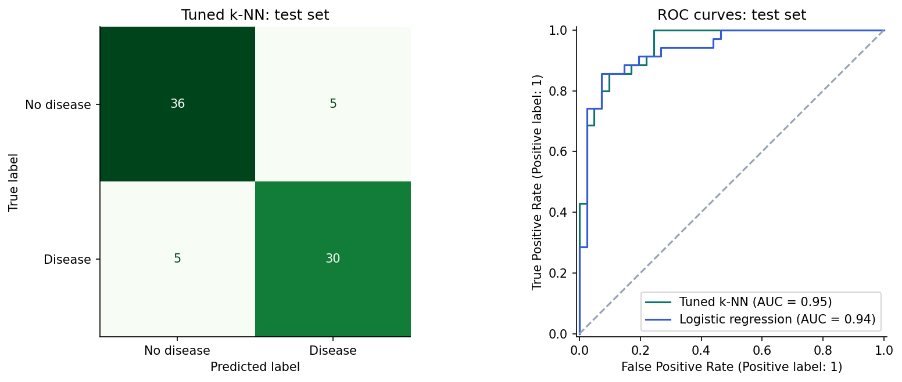
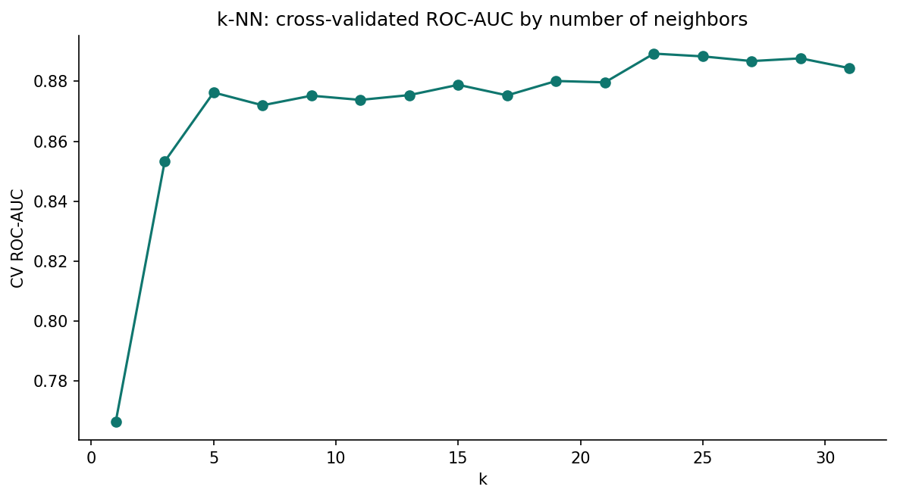
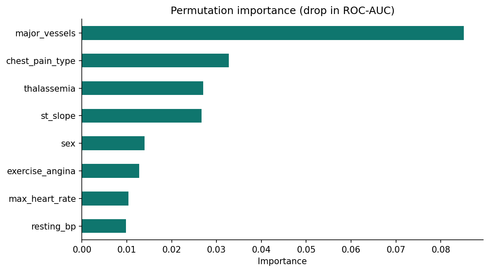

# Heart Disease Prediction

Classifying heart disease from 13 routine clinical measurements on the UCI Cleveland dataset (303 patients), comparing k-nearest neighbors, logistic regression, and random forest with leak-free pipelines and cross-validation.

**Author:** Oluwatoyin Olawale Akadiri · [Portfolio](https://oluwatoyinakadiri.com) · [LinkedIn](https://www.linkedin.com/in/oluwatoyin-akadiri/)

> Educational project. **Not a diagnostic tool.**

## Results at a glance

| Model (held-out test set, 76 patients) | Accuracy | Recall (sensitivity) | ROC-AUC |
|---|---|---|---|
| **Tuned k-NN** (k = 25, distance-weighted) | **86.8%** | 0.857 | **0.949** |
| Logistic regression | 85.5% | 0.857 | 0.937 |
| Baseline (always "no disease") | 54% | 0 | 0.50 |

All model choices were made with 5-fold cross-validation on training data; the test set was used once.

## Key findings

1. **Blocked major vessels, chest pain type, and thalassemia** carry the most predictive signal (permutation importance).
2. **Asymptomatic patients had the highest disease rate (72.9%)**, a counter-intuitive pattern that shows why features should be chosen from data, not assumptions.
3. **k matters for k-NN.** Very small k overfits to single neighbors; performance stabilizes at larger k.







## Methods

- Cleaning: hidden missing values (`?`) handled; 0–4 diagnosis scale converted to a binary target
- `ColumnTransformer` pipeline: median/mode imputation, scaling, one-hot encoding, learned inside each CV fold
- Models: k-NN, logistic regression, random forest, majority-class baseline
- Metrics: accuracy, precision, recall, F1, ROC-AUC, confusion matrix
- `GridSearchCV` over k and distance weighting; permutation importance for interpretation

## Project structure

```
heart-disease-prediction/
├── notebooks/heart_disease_prediction.ipynb   # full analysis with outputs
├── images/                                    # charts used in this README
├── requirements.txt
└── README.md
```

## How to run

```bash
git clone https://github.com/Tropy007/heart-disease-prediction.git
cd heart-disease-prediction
pip install -r requirements.txt
jupyter notebook notebooks/heart_disease_prediction.ipynb
```

The notebook downloads the data from the UCI Machine Learning Repository automatically.

## Limitations

303 patients from one hospital (Cleveland Clinic, 1988). Results would need validation on new and more diverse patients, and missed diagnoses (false negatives) carry real clinical cost.
